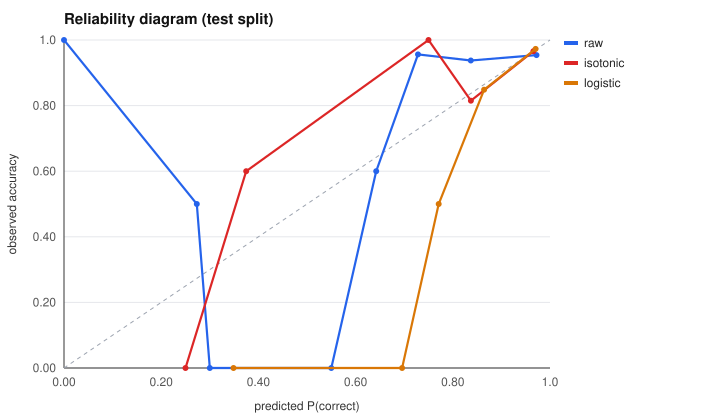
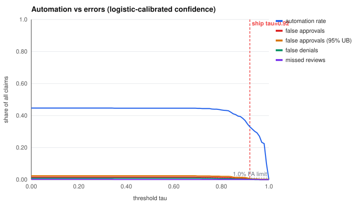
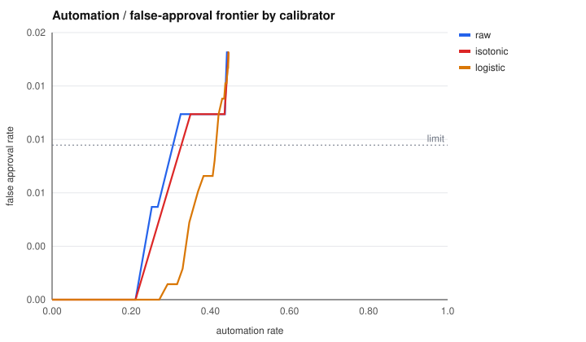

# Claims agent: safe automation threshold

Extractor: **heuristic** · claims: **2000** (half calibration, half test) · false-approval limit: **1.0%**

## Answer

**Ship tau = 0.92**: automate **33.0%** of claims with a measured false-approval rate of 0.2% (95% upper bound 0.6%), false denials 0.2%, missed reviews 0.1%.

Using the point estimate instead of the upper bound would allow tau=0.85 / 41.1% automation, but that margin is inside sampling noise, so it isn't shipped.

Thresholding the *uncalibrated* score instead lands at tau=0.96: 21.1% automation.

## Extraction accuracy (field exact-match, all claims)

| field | accuracy |
|---|---|
| claimant | 98.7% |
| policy_number | 97.8% |
| incident_date | 96.7% |
| incident_type | 97.7% |
| amount | 86.7% |
| evidence | 95.9% |

## Decision accuracy by channel (test)

| channel | accuracy | n |
|---|---|---|
| email | 88.0% | 357 |
| form | 99.7% | 382 |
| scan | 94.3% | 261 |

## Calibration (test split, auto-actionable claims)

| calibrator | ECE | Brier |
|---|---|---|
| raw | 0.073 | 0.064 |
| isotonic | 0.026 | 0.054 |
| logistic ← chosen | 0.013 | 0.048 |

## Threshold sweep

| tau | automation | false approval | FA 95% UB | false denial | missed review |
|---|---|---|---|---|---|
| 0.00 | 44.7% | 1.6% | 2.4% | 0.9% | 0.2% |
| 0.05 | 44.7% | 1.6% | 2.4% | 0.9% | 0.2% |
| 0.10 | 44.7% | 1.6% | 2.4% | 0.9% | 0.2% |
| 0.15 | 44.7% | 1.6% | 2.4% | 0.9% | 0.2% |
| 0.20 | 44.7% | 1.6% | 2.4% | 0.9% | 0.2% |
| 0.25 | 44.7% | 1.6% | 2.4% | 0.9% | 0.2% |
| 0.30 | 44.7% | 1.6% | 2.4% | 0.9% | 0.2% |
| 0.35 | 44.6% | 1.6% | 2.4% | 0.9% | 0.1% |
| 0.40 | 44.6% | 1.6% | 2.4% | 0.9% | 0.1% |
| 0.45 | 44.6% | 1.6% | 2.4% | 0.9% | 0.1% |
| 0.50 | 44.6% | 1.6% | 2.4% | 0.9% | 0.1% |
| 0.55 | 44.6% | 1.6% | 2.4% | 0.9% | 0.1% |
| 0.60 | 44.6% | 1.6% | 2.4% | 0.9% | 0.1% |
| 0.65 | 44.6% | 1.6% | 2.4% | 0.9% | 0.1% |
| 0.70 | 44.5% | 1.5% | 2.3% | 0.9% | 0.1% |
| 0.75 | 44.4% | 1.5% | 2.3% | 0.8% | 0.1% |
| 0.80 | 43.5% | 1.3% | 2.0% | 0.6% | 0.1% |
| 0.85 | 41.1% | 0.9% | 1.5% | 0.5% | 0.1% |
| 0.90 | 36.9% | 0.7% | 1.3% | 0.2% | 0.1% |
| 0.95 | 29.2% | 0.1% | 0.4% | 0.0% | 0.1% |
| 1.00 | 0.0% | 0.0% | 0.3% | 0.0% | 0.0% |

## Decision reasons (test)

| reason | count |
|---|---|
| over_limit | 356 |
| all_checks_pass | 335 |
| missing_evidence | 112 |
| unreadable_field | 67 |
| not_covered | 45 |
| early_claim | 43 |
| outside_coverage_window | 31 |
| unknown_policy | 11 |

## Sample false approvals (what the threshold must screen out)

- `CLM-01018` (email): truth=request_evidence, raw conf=0.95, extracted amount=1097.3
- `CLM-01401` (email): truth=request_evidence, raw conf=0.95, extracted amount=8806.87
- `CLM-01719` (email): truth=route_reviewer, raw conf=0.95, extracted amount=250.0
- `CLM-01032` (email): truth=request_evidence, raw conf=0.95, extracted amount=815.84
- `CLM-00007` (email): truth=route_reviewer, raw conf=0.55, extracted amount=1300.0
